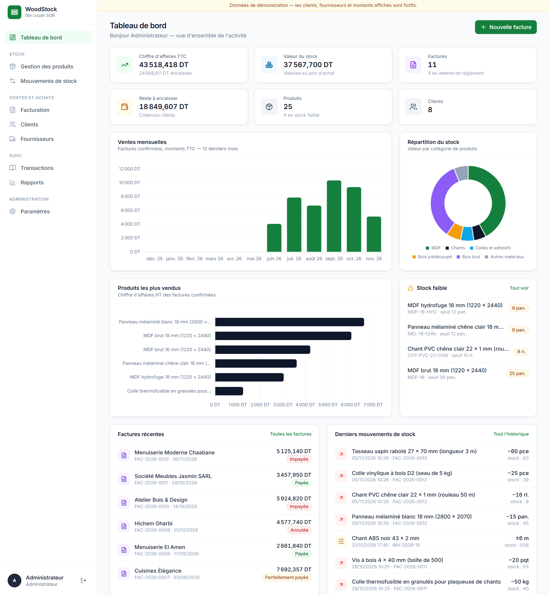
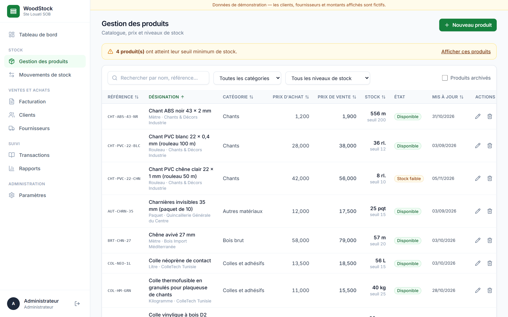
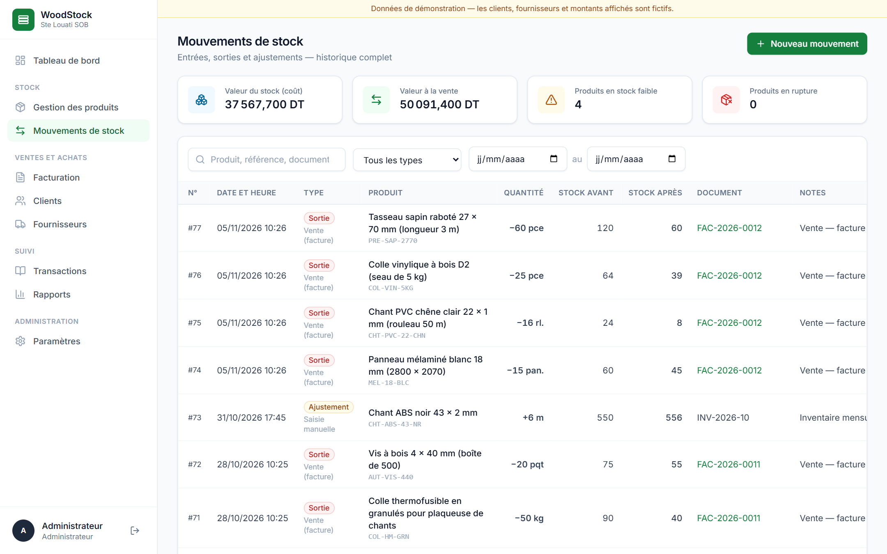
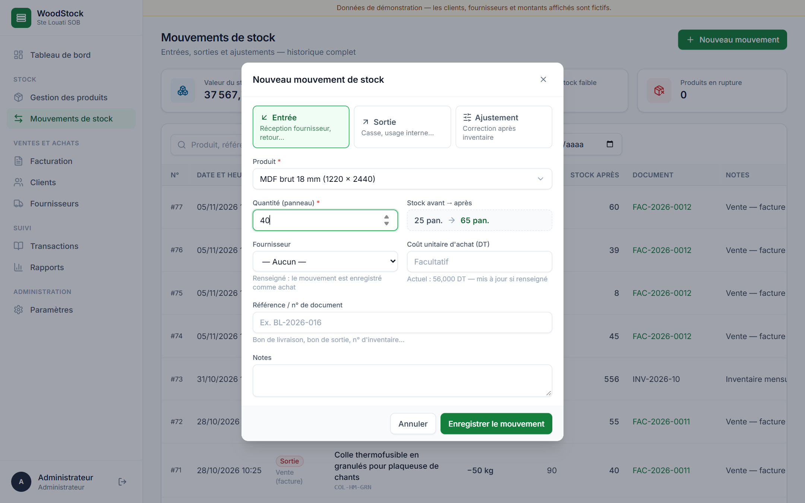
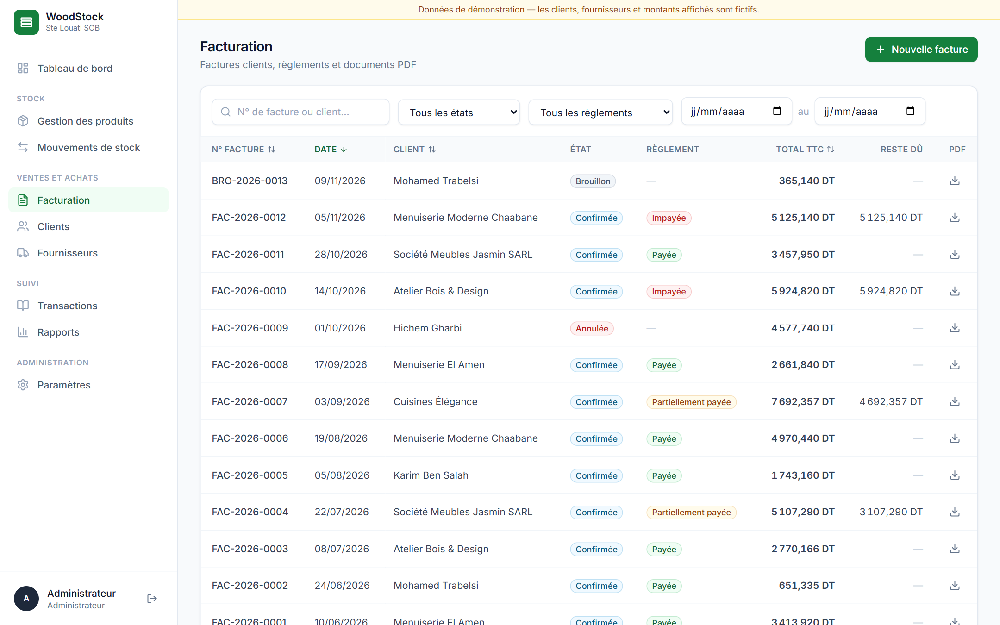
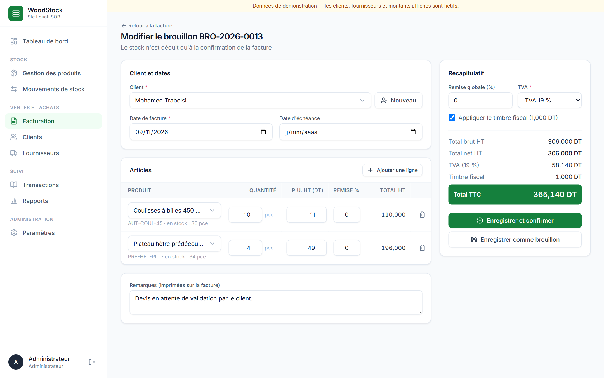
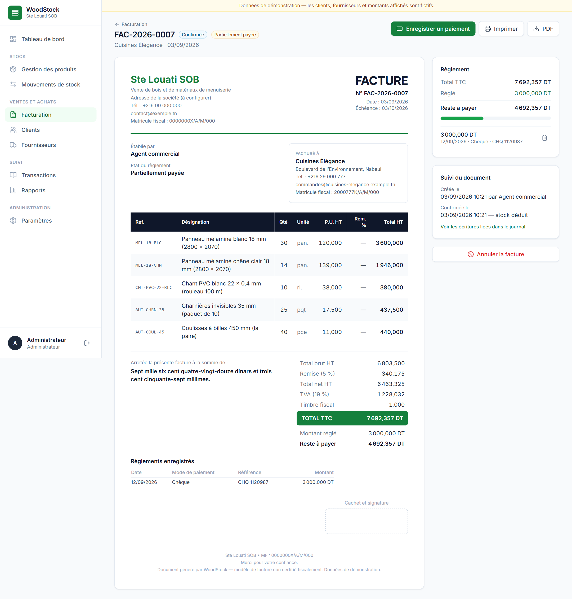
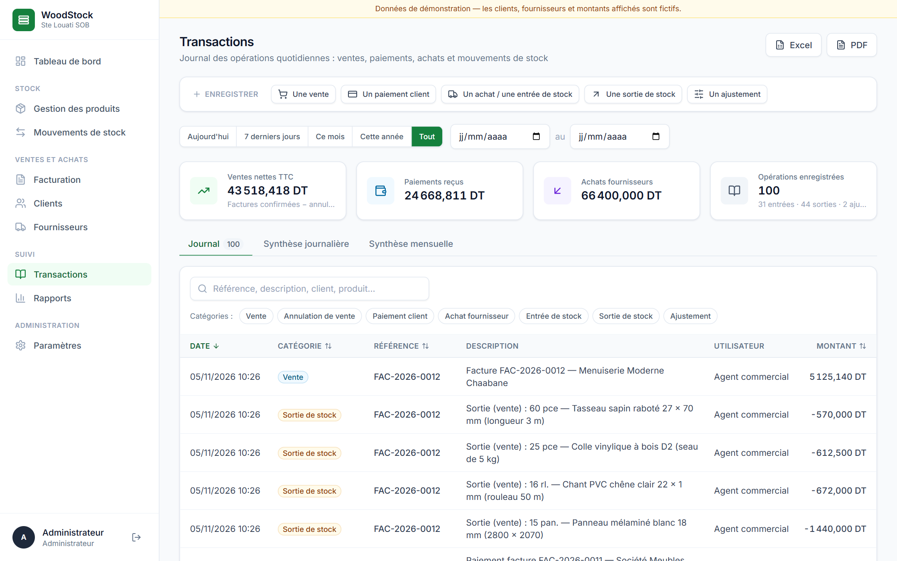
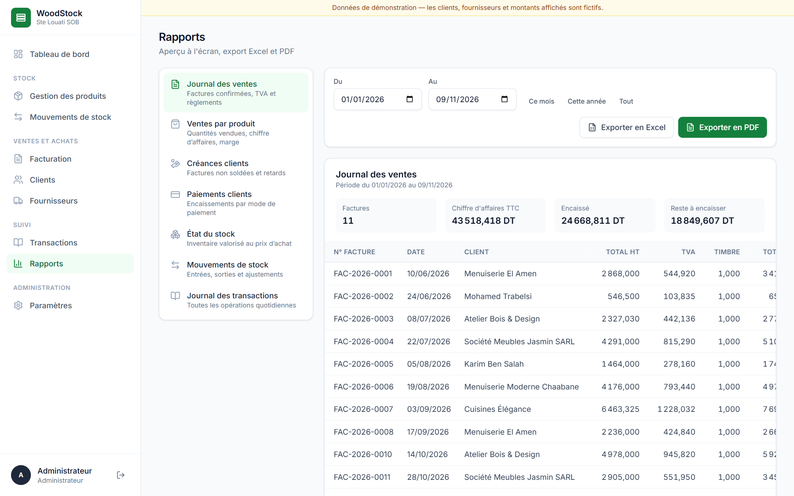

# WoodStock — Wood Trading & Inventory Management System

Internal management software for **Ste Louati SOB**, a Tunisian company selling wood and woodworking materials (MDF panels, edging strips, glues, pre-cut and raw wood, accessories).

The application covers the three activities of the internship project:

1. **Digital invoicing and billing** — invoices in Tunisian Dinar with configurable VAT, discounts, stamp duty, payments, PDF and print.
2. **Inventory and stock management** — product catalogue, stock movements (in / out / adjustment), low-stock alerts, full history.
3. **Data entry and database management** — customers, suppliers, a daily transaction journal, summaries, Excel and PDF reports.

The user interface is in **French** (dates `JJ/MM/AAAA`, amounts `1 234,500 DT`).

> **Demonstration data.** The seed script fills the database with *fictional* customers, suppliers, tax IDs, invoices and amounts so that every screen can be demonstrated. They are not real records of the company. The invoice template is suited to a Tunisian business but is **not** a legally or fiscally certified document.



---

## Table of contents

- [Features](#features)
- [Technology stack](#technology-stack)
- [Architecture](#architecture)
- [Installation](#installation)
- [Running the application](#running-the-application)
- [Demo accounts](#demo-accounts)
- [Database](#database)
- [Business rules](#business-rules)
- [API overview](#api-overview)
- [Tests](#tests)
- [Screenshots](#screenshots)

---

## Features

| Module | What it does |
| --- | --- |
| **Tableau de bord** | Revenue, stock value, receivables, counts of products / customers / invoices, low-stock list, recent invoices and movements. Charts: monthly sales, best-selling products, stock value by category. Everything is computed from database records. |
| **Gestion des produits** | Create, edit, archive/delete with safeguards, search, filter by category and stock level, sort, product sheet with movement history, low-stock warnings. Seven units (pièce, panneau, mètre, rouleau, kilogramme, litre, paquet). |
| **Mouvements de stock** | Stock IN (supplier reception, with cost), OUT (breakage, internal use) and ADJUSTMENT (inventory count). Each movement stores previous and new quantity, document reference, notes, user and timestamp. |
| **Facturation** | Draft → confirmed → cancelled life cycle. Multi-line invoices, automatic prices, line and global discounts, configurable VAT, stamp duty, amount in words, payments (cash, bank transfer, cheque, other), payment status, printable sheet and PDF download. |
| **Clients / Fournisseurs** | Contact sheets with tax ID (matricule fiscal), search, customer purchase history and balance, supplier stock entries and supplied products. |
| **Transactions** | Daily journal fed automatically by sales, payments, purchases and stock movements. Date filters, categories, search, sorting, daily and monthly summaries, Excel and PDF export. |
| **Rapports** | Sales journal, sales by product, receivables, payments, stock valuation, stock movements, transaction journal — on-screen preview, Excel and PDF. |
| **Paramètres** | Company details, VAT rates, stamp duty, product categories, user accounts and roles (administrator only); password change for everyone. |

## Technology stack

| Layer | Technologies |
| --- | --- |
| Frontend | React 18, React Router 6, Axios, Tailwind CSS 3, Chart.js 4 (react-chartjs-2), lucide-react icons, Vite |
| Backend | Node.js (≥ 18), Express 4, mysql2, JSON Web Tokens, bcryptjs, zod (validation), helmet, express-rate-limit |
| Documents | PDFKit (invoices and reports), ExcelJS (Excel exports) |
| Database | MySQL 8 (also runs on MariaDB 10.4+, e.g. XAMPP) |

## Architecture

```
WoodStock/
├── database/
│   ├── schema.sql            # tables, keys, constraints, indexes + reference data
│   └── seed.sql              # demonstration data (generated by backend/scripts/seed.js)
├── backend/
│   ├── .env.example
│   ├── scripts/
│   │   ├── init-db.js        # npm run db:init  → schema.sql + seed.sql
│   │   ├── seed.js           # npm run db:seed  → regenerates the demo data through the services
│   │   └── smoke-test.js     # npm test         → end-to-end API tests
│   └── src/
│       ├── server.js, app.js
│       ├── config/           # environment, MySQL pool, transaction helper
│       ├── middleware/       # JWT authentication, roles, validation, error handling
│       ├── routes/           # REST endpoints, one file per module
│       ├── services/         # business logic: stock, invoices, payments, journal, reports, PDF, Excel
│       └── utils/
├── frontend/
│   └── src/
│       ├── api/              # Axios client (token, errors, file downloads)
│       ├── context/          # authentication context
│       ├── components/       # layout, UI kit, shared forms (product, partner, movement, payment)
│       ├── pages/            # one page per screen
│       └── utils/            # French formatting, labels, hooks
└── docs/
    ├── screenshots/
    └── report/               # internship report (PDF + Word)
```

The frontend never talks to the database: it calls the REST API (`/api/...`) with a JWT. Every rule that matters (stock never negative, invoice totals, payment limits, role permissions) is enforced by the **backend services**, inside **SQL transactions**; the frontend repeats some checks only to give immediate feedback.

## Installation

### Prerequisites

- **Node.js 18 or later** (with npm)
- **MySQL 8** or MariaDB 10.4+ running locally (XAMPP, WAMP, MySQL Installer, Docker…)

### 1. Get the code

```bash
git clone https://github.com/Sliv3er/woodstock.git
cd woodstock
```

### 2. Install dependencies

```bash
npm run install:all
```

(or `npm install` inside `backend/` and inside `frontend/`).

### 3. Configure the backend

```bash
cp backend/.env.example backend/.env
```

Edit `backend/.env`:

| Variable | Meaning | Default |
| --- | --- | --- |
| `PORT` | API port | `5000` |
| `DB_HOST`, `DB_PORT` | MySQL server | `127.0.0.1`, `3306` |
| `DB_USER`, `DB_PASSWORD` | MySQL account | `root`, empty |
| `DB_NAME` | Database name | `woodstock` |
| `JWT_SECRET` | Secret used to sign sessions — use a long random value | — |
| `JWT_EXPIRES_IN` | Session duration | `8h` |
| `CORS_ORIGIN` | Allowed frontend origin | `http://localhost:5173` |

### 4. Create the database

Start MySQL, then:

```bash
npm run db:init
```

This runs `database/schema.sql` then `database/seed.sql` (it **drops and recreates** the WoodStock tables). The same can be done by hand:

```bash
mysql -u root -p < database/schema.sql
mysql -u root -p woodstock < database/seed.sql
```

To start with an empty database and a single administrator (`admin` / `admin123`):

```bash
npm run db:init --prefix backend -- --empty
```

## Running the application

Open two terminals:

```bash
npm run dev:api
```

```bash
npm run dev:web
```

Then open **http://localhost:5173**. The API listens on http://localhost:5000 (`GET /api/health` checks the API and the database).

**Single-process mode.** `npm run build` compiles the frontend into `frontend/dist`; `npm start` then serves both the API and the interface on http://localhost:5000.

## Demo accounts

| Role | Username | Password | Rights |
| --- | --- | --- | --- |
| Administrateur | `admin` | `admin123` | Everything, including settings, users, VAT rates, categories, stock adjustments, invoice cancellation, deletions |
| Employé | `employe` | `employe123` | Daily operations: products, stock in/out, customers, suppliers, invoices, payments, reports |

These accounts exist for demonstration only — change the passwords (Paramètres → Mon compte) before any real use.

## Database

Normalized MySQL schema (InnoDB, utf8mb4), defined in [`database/schema.sql`](database/schema.sql):

| Table | Purpose |
| --- | --- |
| `users` | Accounts, bcrypt password hash, role (`admin` / `employee`) |
| `categories`, `suppliers`, `customers` | Reference data |
| `products` | Catalogue, prices, current quantity, minimum threshold, supplier |
| `invoices`, `invoice_items` | Invoice header and lines; amounts and VAT rate are stored (snapshot) |
| `payments` | Customer payments linked to an invoice |
| `stock_movements` | Immutable stock history: type, quantity, previous / new quantity, source, document, user |
| `transactions` | Daily journal: one entry per sale, cancellation, payment, purchase or stock movement |
| `vat_rates`, `settings` | Configurable VAT rates, company details, stamp duty |
| `sequences` | Yearly counters for invoice numbering |

Integrity is enforced at database level as well: primary and foreign keys, unique keys (SKU, invoice number, one line per product per invoice, one stock movement per invoice/product/source, idempotency key), `CHECK` constraints (quantity ≥ 0, amount paid ≤ total), and indexes on the search and join columns.

## Business rules

- **Stock is only changed by movements.** A product's quantity cannot be edited directly; initial stock, receptions, sales, cancellations and inventory corrections each create a movement recording the quantity before and after.
- **Stock is never negative.** Each movement locks the product row (`SELECT … FOR UPDATE`), checks availability and writes the product, the movement and the journal entry in one transaction. Concurrent requests cannot oversell.
- **Confirming an invoice** checks every line against the stock (a shortage refuses the whole confirmation and lists the missing products), assigns the final gap-free number `FAC-YYYY-NNNN`, deducts the stock with one OUT movement per line and records the sale in the journal. Drafts (`BRO-…`) have no effect on stock.
- **Payments** cannot exceed the remaining balance; the payment status (unpaid / partially paid / paid) is recomputed on each payment.
- **Cancelling an invoice** (administrator) is refused while payments exist, restores the stock with one IN movement per line and adds a reversing journal entry. A row lock plus a unique key guarantee the stock is restored exactly once, even if two cancellations are sent at the same time.
- **No duplicates.** Every stock form carries an idempotency key, so a double click or a network retry creates a single movement.
- **Deletions are safe.** A product with remaining stock cannot be deleted; a product with history is archived instead; customers and suppliers linked to documents cannot be deleted; every destructive action asks for confirmation.
- **Security.** Passwords hashed with bcrypt, JWT-protected API, role checks on the server, validated input (zod), parameterized SQL queries only, rate-limited login, HTTP security headers.

## API overview

All routes are prefixed with `/api` and, except login and health, require `Authorization: Bearer <token>`.

| Route | Description |
| --- | --- |
| `POST /auth/login`, `GET /auth/me`, `PUT /auth/password` | Authentication |
| `GET /dashboard` | Statistics and chart data |
| `GET/POST /products`, `GET/PUT/DELETE /products/:id` | Products (search, `category_id`, `stock`, `sort`, `order`, `page`) |
| `GET/POST /stock/movements`, `GET /stock/summary` | Stock movements |
| `/customers`, `/suppliers` (+ `/:id`) | CRUD, history |
| `GET/POST /invoices`, `GET/PUT/DELETE /invoices/:id` | Invoices |
| `POST /invoices/:id/confirm`, `POST /invoices/:id/cancel`, `GET /invoices/:id/pdf` | Life cycle and PDF |
| `GET/POST /payments`, `DELETE /payments/:id` | Payments |
| `GET /transactions`, `GET /transactions/summary` | Journal and summaries |
| `GET /reports/:type[?format=xlsx|pdf]` | `sales`, `products`, `receivables`, `payments`, `stock`, `movements`, `transactions` |
| `/settings`, `/settings/vat-rates`, `/categories`, `/users` | Configuration (administrator for writes) |

## Tests

With the API running (`npm run dev:api`):

```bash
npm test
```

The script runs 63 end-to-end checks through the HTTP API: authentication and roles, validation, stock in/out/adjustment, refusal of negative stock, duplicate and concurrent requests, invoice totals, confirmation and stock deduction, payments, PDF and Excel generation, controlled cancellation and data consistency. It creates its own `TEST-…` records; run `npm run db:init` afterwards to restore the demonstration data.

## Screenshots

| | |
| --- | --- |
|  Products |  Stock movements |
|  New stock movement |  Invoices |
|  Invoice editor |  Invoice sheet |
|  Transaction journal |  Reports |

## Internship report

The internship report describing the analysis, design and implementation of this project is available in [`docs/report`](docs/report) (PDF and Word).
